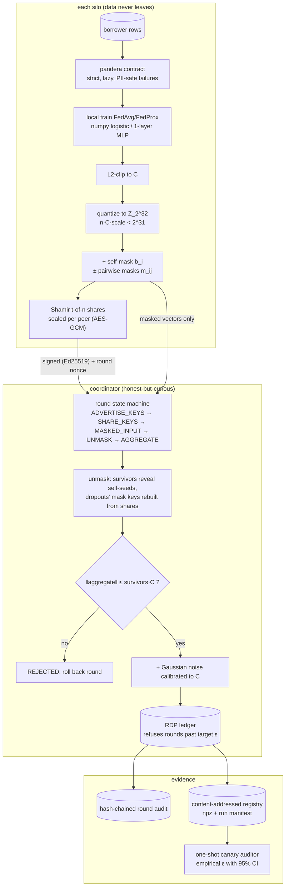

# federated-secure-aggregation

Cross-silo federated training of a credit-default model where the coordinator only ever sees the
**masked sum** of client updates, rounds survive client dropouts, and the differential-privacy
claim is checked empirically by a canary audit that catches broken implementations.

## Problem

Lenders cannot pool borrower data, so they train federated. But plain federated averaging still
hands the server each silo's raw update, which is enough to reconstruct training examples. Three
things usually go wrong from there:

- **The server still sees individual updates.** Secure aggregation fixes this, but the textbook
  version breaks whenever a client drops out mid-round, which is the normal case over WAN links.
- **"We used DP" is rarely checked.** A clipping bug, a misplaced noise call, or dividing the
  sensitivity by `n` silently voids the guarantee while every number in the logs still looks
  plausible. The accountant keeps reporting the epsilon you asked for.
- **Hiding updates hides attacks too.** Once the server cannot inspect a contribution, it cannot
  tell a poisoned one from an honest one. This trade-off is usually left unstated.

This repo implements the protocol properly, makes the dropout path a first-class case, and then
tries to *falsify* its own privacy claim: three deliberately broken variants are audited alongside
the correct one, and CI fails if the audit does not flag exactly the broken ones.

## Architecture



The coordinator's transcript contains masked vectors and nothing else. Summing over a set in which
both members of every pair survived cancels the pairwise masks exactly; the self-mask is what makes
dropouts recoverable without leaking, because at unmask time the coordinator learns *either* a
survivor's self-mask seed *or* a dropout's mask key, never both for the same silo
(`reconstruct_aggregate` refuses a request that asks for both).

Simplified from Bonawitz et al., *Practical Secure Aggregation for Privacy-Preserving Machine
Learning* (CCS 2017). The audit method follows Andrew et al., *One-shot Empirical Privacy
Estimation for Federated Learning* (2023). Both are cited as algorithms; the code here is original.

Layout:

```text
src/federated_secure_aggregation/
  crypto/      field, keys (X25519/Ed25519/HKDF), AES-CTR PRG, Shamir over GF(2^8)
  secagg/      quantize, masking, messages, client, coordinator, session
  privacy/     RDP accountant, Gaussian noise, budget ledger, canary auditor
  fl/          data + Dirichlet partition, models, local training, simulation, baselines
  service/     FastAPI coordinator, HTTP silo driver, runtime wiring
  monitoring/  hash-chained round audit, Prometheus round metrics
  ml/          pandera contract, run manifest, registry, drift, npz serialization
bench/  bench_baseline|secagg|utility|audit|poisoning.py   tests/unit, tests/integration
docs/THREAT_MODEL.md   docs/adr/   CLAIMS.md   MODEL_CARD.md
```

## Quickstart

Requirements: [uv](https://docs.astral.sh/uv/) and Python 3.12. Everything below runs offline on a
CPU; no API key, no downloads, no GPU.

```bash
uv sync --frozen
uv run python tasks.py demo    # 20 rounds, 2 dropouts, 1 poisoned round rejected (~5 s)
uv run python tasks.py check   # ruff, mypy --strict, pytest + coverage, bandit, pip-audit, baseline
uv run python tasks.py bench   # 5 benches with regression thresholds (~35 s)
```

On Windows with a small repository drive, keep the environment elsewhere first:
`$env:UV_PROJECT_ENVIRONMENT = "C:/Users/<you>/.venvs/federated-secure-aggregation"`.

The demo prints a per-round table and a JSON summary. Round 7 loses two of five silos and still
completes; round 12 contains a silo whose update is scaled 40x and is rejected and rolled back:

```text
| round | survivors | dropouts | accepted | agg norm | bound | epsilon | AUC |
|---|---|---|---|---|---|---|---|
| 6  | 5 | 0 | yes | 3.9960 | 5 | 4.3407 | 0.6726 |
| 7  | 3 | 2 | yes | 2.2780 | 3 | 4.7088 | 0.5806 |
| 8  | 5 | 0 | yes | 4.2830 | 5 | 5.0158 | 0.7080 |
| 12 | 5 | 0 | no  | 15.02  | 5 | 5.9368 | -      |
```

Inspect the evidence the run leaves behind:

```bash
uv run federated-secure-aggregation audit verify var/demo/round_audit.jsonl
uv run federated-secure-aggregation budget var/demo/budget.json
```

Run the coordinator service. Identity keys are generated once, outside the repository, and mounted
read-only; they are never generated at start-up, because a coordinator whose key silently changed
would be indistinguishable from an impersonator. A coordinator with no roster refuses to serve
rather than accepting unauthenticated silos:

```bash
uv run python scripts/generate_identities.py --silos 5   # writes secrets/, git-ignored
set -a && . ./secrets/compose.env && set +a              # one transport key per identity
APP_API_KEY_SHA256=$APP_SILO_API_KEY_SHA256 \
  APP_OPERATOR_API_KEY_SHA256=$APP_OPERATOR_API_KEY_SHA256 \
  uv run federated-secure-aggregation serve
curl -s http://127.0.0.1:8000/healthz
```

Transport keys are per identity, and the digest lists are split by role: `APP_API_KEY_SHA256`
holds the silo keys, `APP_OPERATOR_API_KEY_SHA256` the operator's. A single shared key would make
"operator route" a comment rather than a control — any silo could open rounds and drive stage
advances — and would put every process in one token bucket, because the rate limiter keys on the
presented key. Six normal pollers then look like a flood and the coordinator throttles its own
federation.

Containers: `docker compose up --build` runs a coordinator, an operator and five silo containers on
an internal network. Each silo mounts exactly one private key — its own — plus the public roster,
and there is no shared volume anywhere, so a silo's rows cannot reach another container. The
operator holds no key material and cannot close a stage early to isolate a silo. Container build,
smoke test, trivy scan, SBOM generation and the five-silo compose run with two silos killed
mid-round are verified in CI (`.github/workflows/ci.yml`, jobs `docker` and `compose`); **Docker
was not run locally as part of building this repo.**

The same two loops are covered without Docker by
`tests/integration/test_silo_runner.py`, which runs five silo threads and an operator against the
real ASGI app.

## Results

Measured with `uv run python tasks.py bench` on 2026-09-20: Windows 10 (10.0.19045), Intel64
Family 6 Model 158, 6 logical CPUs, Python 3.12.14, CPU only. Every run printed "all benchmarks
within thresholds". CI runs the same command against the looser limits in `bench/thresholds.json`.
These are single-machine numbers for catching regressions, not performance claims.

### Exactness and cost of the protocol — `bench/bench_secagg.py --check`

The unmasked aggregate must equal the plaintext quantized sum **bit for bit**, including when
clients drop out. It did for every configuration below (`exact_fraction = 1.0`), and
`tests/unit/test_secagg_exactness.py` pins the same property over 200 hypothesis cases.

| clients | threshold | dropouts | survivors | exact | seconds | bytes/client |
|---:|---:|---:|---:|---|---:|---:|
| 3 | 2 | 0 | 3 | yes | 0.0271 | 4 675 |
| 3 | 2 | 1 | 2 | yes | 0.0113 | 3 522 |
| 5 | 3 | 0 | 5 | yes | 0.0265 | 5 391 |
| 5 | 3 | 2 | 3 | yes | 0.0242 | 3 962 |
| 10 | 6 | 0 | 10 | yes | 0.0839 | 7 181 |
| 10 | 6 | 4 | 6 | yes | 0.0774 | 5 639 |
| 20 | 11 | 0 | 20 | yes | 0.3189 | 10 762 |
| 20 | 11 | 9 | 11 | yes | 0.2918 | 8 770 |

Bytes per client grow with the number of peers (one Shamir share and one pairwise mask each), and
a 20-silo round costs about 0.32 s of wall clock in process.

### Utility: what privacy costs — `bench/bench_utility.py --check`

AUC on a held-out split, 1 345-parameter model, Dirichlet non-IID partitions. "federated
(protocol)" runs the full masking protocol; "federated" is the same arithmetic in the clear.

| alpha | model | epsilon | noise z | AUC | log loss |
|---:|---|---|---:|---:|---:|
| 0.1 | centralized | - | 0 | 0.8563 | 0.3306 |
| 0.1 | local-only | - | 0 | 0.7562 | 1.0440 |
| 0.1 | federated | inf | 0 | 0.8584 | 0.3691 |
| 0.1 | federated (protocol) | inf | 0 | **0.8584** | 0.3691 |
| 0.1 | federated | 8 | 2.8536 | 0.7173 | 0.6772 |
| 1 | centralized | - | 0 | 0.8681 | 0.3317 |
| 1 | local-only | - | 0 | 0.8413 | 0.6379 |
| 1 | federated | inf | 0 | 0.8690 | 0.3305 |
| 1 | federated (protocol) | inf | 0 | **0.8690** | 0.3305 |
| 1 | federated | 4 | 5.1777 | 0.7199 | 0.5978 |
| 1 | federated | 8 | 2.8536 | 0.7837 | 0.4215 |
| 10 | centralized | - | 0 | 0.8851 | 0.3057 |
| 10 | local-only | - | 0 | 0.8736 | 0.3217 |
| 10 | federated | inf | 0 | 0.8862 | 0.3047 |
| 10 | federated (protocol) | inf | 0 | **0.8862** | 0.3047 |
| 10 | federated | 8 | 2.8536 | 0.7891 | 0.3886 |

Three things to read off this table:

- **Secure aggregation is free in accuracy.** The protocol and plaintext rows are identical to four
  decimals at every alpha; the measured gap is 0.0000 against a 0.005 threshold. Masking is exact
  arithmetic, not an approximation.
- **Federating is worth it, most at the hardest skew.** At alpha = 0.1 federated beats local-only by
  10.2 AUC points; at alpha = 10 the silos are nearly IID and the gap shrinks to 1.3 points.
  Federated matches centralized within 0.002 everywhere.
- **Differential privacy is the expensive part.** At epsilon = 8 the model loses 8.5 AUC points
  (0.8690 to 0.7837 at alpha = 1); at epsilon = 1 it collapses to near chance (0.5646). On a model
  this size, with 20 rounds and 5 silos, a single-digit epsilon is genuinely costly. The
  `epsilon = 1` rows are reported precisely because it would be easy to omit them.

### Privacy audit: does the claim survive contact with the data? — `bench/bench_audit.py --check`

48 canary clients submit random unit-direction updates in a single training run. The cosine between
the final model delta and the canary directions, against 1 024 fresh random directions, yields an
empirical mu and a 95% lower confidence bound. A variant is **flagged** when its lower bound exceeds
the claimed epsilon.

| variant | breaks DP? | mu hat | eps hat | eps low (95%) | claimed eps | flagged |
|---|---|---:|---:|---:|---:|---|
| correct | no | 1.1736 | 5.2740 | 3.7665 | 6.8379 | no |
| no_clipping | **yes** | 5.0902 | 33.94 | 31.57 | 6.8379 | **yes** |
| weak_noise | **yes** | 4.6750 | 30.16 | 28.08 | 6.8379 | **yes** |
| average_sensitivity | **yes** | 4.9635 | 32.77 | 30.52 | 6.8379 | **yes** |
| clip_after_noise | no | 1.1778 | 5.2960 | 3.7847 | 6.8379 | no |

All 3 broken variants are flagged and neither sound variant is; CI fails on any other outcome. The
correct implementation's empirical mu of 1.1736 sits below the theoretical mu of 1.3693
(`sqrt(T)/z`), which is the expected direction: the audit is a lower bound on privacy loss, so it
should under-estimate, never over-estimate. `mu_recovery_ratio = 0.857`.

`clip_after_noise` is included deliberately as a *near miss*: clipping after adding noise is a real
bug, but at this noise scale it barely changes the observable distribution, so the audit does not
catch it. An empirical audit rules out gross errors, not subtle ones — see Non-goals.

### Poisoning: what the norm bound can and cannot do — `bench/bench_poisoning.py --check`

Norm bound = survivors x clip_norm = 5.0.

| attacker | scale | rounds rejected | holdout AUC | mean aggregate norm |
|---|---:|---:|---:|---:|
| none | 0 | 0 | 0.8745 | 1.4599 |
| scaled | 1.5 | 0 | 0.8756 | 1.3141 |
| scaled | 2 | 1 | 0.5000 | 5.1473 |
| scaled | 3 | 1 | 0.5000 | 6.3352 |
| scaled | 5 | 1 | 0.5000 | 8.8860 |
| scaled | 10 | 1 | 0.5000 | 12.86 |
| scaled | 40 | 1 | 0.5000 | 14.72 |
| sign-flip x1 | 1 | 0 | 0.8708 | 1.8435 |
| sign-flip x2 | 1 | 0 | 0.8671 | 2.0611 |

Scaled attacks at 2x and above are caught **100% of the time** with no false positives on clean
rounds. That is the whole of the defense, and the last two rows are the honest half of the result:
a **sign-flipping attacker that respects the norm bound is never rejected**. It only costs 0.4-0.7
AUC points here, but nothing in this design detects it, and the coordinator cannot attribute it to
a silo even in principle — that is the price of secure aggregation. Per-client attribution would
need ZK range proofs and is a documented non-goal.

### Micro-benchmarks — `bench/bench_baseline.py --check`

| benchmark | runs | p50 (us) | p95 (us) |
|---|---:|---:|---:|
| pairwise_mask_1k | 500 | 102.0 | 105.2 |
| prg_expand_1k | 2000 | 12.8 | 13.3 |
| mask_vector_1k_10_peers | 100 | 1 233 | 1 274 |
| shamir_split_32b_5of10 | 2000 | 125.8 | 153.9 |
| shamir_combine_32b_5of10 | 2000 | 628.2 | 695.7 |
| ring_add_1k | 5000 | 14.0 | 14.5 |
| quantize_encode_1k | 5000 | 32.9 | 36.8 |
| message_sign | 2000 | 107.8 | 116.8 |
| message_verify | 2000 | 131.1 | 138.4 |
| rdp_epsilon_20_steps | 2000 | 23.1 | 26.0 |
| rdp_curve_all_orders | 50 | 6 855 | 7 042 |
| drift_check_10k_vs_10k | 30 | 2 614 | 2 821 |
| rate_limiter_check | 20000 | 1.8 | 1.9 |

## Security

Threats, controls and the tests that prove them are in [docs/THREAT_MODEL.md](docs/THREAT_MODEL.md);
every claim above and below maps to a test, bench or CI job in [CLAIMS.md](CLAIMS.md).

Adversary model: **honest-but-curious coordinator** for privacy, **malicious clients** for
integrity. A malicious coordinator is a non-goal.

- **Only masked vectors cross the wire.** An integration test reconstructs every request body the
  server received during a real round and asserts that no silo's plaintext update appears, in
  either float or quantized encoding. Masked words pass a chi-square uniformity test over the ring.
- **Signed messages with round nonces.** Every protocol message is Ed25519-signed with a
  pre-provisioned identity key and bound to the round nonce, so an advertised key cannot be
  substituted and a captured message cannot be replayed into a later round.
- **No silo can be unmasked individually.** The coordinator learns a survivor's self-mask seed or a
  dropout's mask key, never both; asking for both raises rather than returning a value. Recovery
  fails by design when survivors fall below the threshold `t`.
- **Aggregate norm bound with rollback.** Rounds whose unmasked aggregate exceeds `survivors x C`
  are rejected and rolled back. Attribution to a silo is impossible by construction and documented
  as unsupported rather than approximated.
- **Enforced privacy budget.** An in-repo RDP accountant for the subsampled Gaussian feeds a
  persisted ledger that refuses rounds past the target `(epsilon, delta)`. It is cross-checked
  against Google's `dp-accounting` in the dev group, and CI fails if the audited epsilon's lower
  confidence bound exceeds the accountant's epsilon.
- **Data contract before anything else.** Each silo validates its own rows against a strict pandera
  schema first. Failure summaries carry column, check and count only — never a borrower value —
  because that summary is the one artifact that might be logged or forwarded.
- **Tamper-evident round log.** Participants, dropouts, aggregate digest and epsilon spent are
  hash-chained per round and verifiable from the CLI against an expected head.
- **Key material is never committed.** Identity keys are generated at setup and mounted read-only;
  only `.env.example` ships. Silo containers share no volume, so raw data cannot leave a container.
- CI: ruff, mypy --strict, pytest with an 85% coverage floor, bandit, semgrep with repo rules,
  pip-audit, gitleaks, hadolint, trivy image scan and a syft CycloneDX SBOM, plus the bench
  regression thresholds and a compose integration job. See [SECURITY.md](SECURITY.md).

## Non-goals

- **A malicious coordinator.** Privacy holds against a coordinator that follows the protocol and
  reads the transcript. One that lies about the survivor set can isolate a silo (the classic
  attack); defending that needs a verifiable-shuffle or attested server and is out of scope.
- **Local DP.** Noise is added centrally by the coordinator, so the guarantee is trusted-curator
  central DP over the masked sum. Silos are protected from each other and from anyone reading the
  transcript, not from a coordinator that discards the protocol.
- **An epsilon that covers the accept/reject decision.** The norm bound is applied to the
  *noiseless* aggregate, and the outcome is published: in the demo table, in the hash-chained
  audit record and in `rounds_rejected_total`. That is one data-dependent bit per round released
  outside the accountant, so the true privacy loss is the reported epsilon **plus** that bit per
  round. A rejected round charges the ledger nothing, which keeps the bookkeeping honest but does
  not make the bit free. Testing the bound against the noised aggregate instead would make the
  decision post-processing and close the gap; it would also change what the bound means as a
  poisoning defence, so it is recorded here rather than done quietly.
- **Per-client attribution of poisoning.** By design the coordinator cannot see who sent what. Only
  round-level rejection is available; sign-flip attacks inside the norm bound are undetected and
  measured above rather than hidden.
- **A privacy audit that proves correctness.** The canary audit is a statistical **lower** bound on
  privacy loss. It reliably catches gross errors (no clipping, weak noise, averaged sensitivity)
  and demonstrably misses at least one subtle one (`clip_after_noise`). Passing the audit is not a
  proof that the implementation is correct.
- **Production-grade cryptography.** Shamir sharing is over GF(2^8) for clarity, masks use AES-CTR
  as a PRG, and nothing here is constant-time beyond what `cryptography` provides. This is a
  faithful, readable implementation for study, not a hardened library.
- **Byte-reproducible runs.** The learning is bit-for-bit reproducible from the seed (partition
  fingerprint, per-round aggregate digests and every published metric match across runs). The audit
  chain and model version deliberately do not, because each round record commits to its wall-clock
  duration and the manifest carries a timestamp.
- **Real borrower data.** The population is synthetic, generated from a known logistic model. AUC
  numbers describe this simulation only and say nothing about real credit risk.
- **Secure dropout below threshold.** If fewer than `t` silos survive a stage, the round fails
  rather than degrading to a weaker reconstruction.
- **Scale.** Pairwise masking is O(n^2) in peers; this targets cross-silo federation (tens of
  participants), not cross-device (millions).
- **An MLflow server or signed model provenance.** The registry is a local content-addressed store.

## License

MIT — see [LICENSE](LICENSE).
