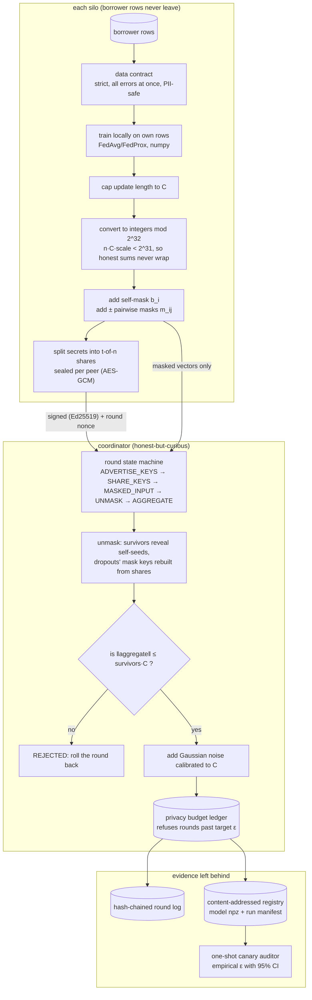

# Federated Secure Aggregation

**Five banks train one shared credit-risk model, and nobody — not the other banks, not the server
coordinating them — ever sees another bank's borrower records or even its individual contribution
to the model.**

A default-prediction model gets sharply better with more borrowers behind it. But a bank cannot
hand its customer files to four competitors, and in most jurisdictions it is not allowed to.
Federated learning is the standard answer: each bank trains on its own rows and sends only a model
update — a list of numbers describing how it wants the shared model to change.

The trouble is that a model update is not anonymous. Published attacks reconstruct individual
training records out of exactly those numbers. So under plain federated averaging the coordinating
server still receives, from each bank, an object its borrowers can be partly recovered from. Three
things go wrong from there, and each has a victim:

- **The server still sees each bank's update.** Secure aggregation fixes that by scrambling updates
  so only their sum can be read. The textbook version breaks the moment one bank drops offline
  mid-round — the normal case over a wide-area link — so federations quietly fall back to the
  version that leaks. Who it hurts: the borrowers whose records sit inside a reconstructable
  update, and the bank that signed a data-protection agreement it is now breaching.
- **"We used differential privacy" is rarely checked.** Differential privacy adds calibrated random
  noise so no single borrower can change the result much; its strength is a number called epsilon,
  where lower means more private. A clipping step that is computed but never applied, a noise call
  in the wrong place, or dividing the sensitivity by the number of banks each void the guarantee
  while every log line still reports the epsilon somebody asked for. Who it hurts: everyone
  downstream of a privacy claim that was never true — and nobody finds out, because a broken
  implementation looks exactly like a working one.
- **Hiding updates hides attacks too.** Once the server cannot inspect a contribution, it cannot
  tell a poisoned one from an honest one. One bank can then steer the shared model — toward
  approving loans it should decline, say — and every standard defence needs the inspection that
  secure aggregation just removed. This trade-off is usually left unstated.

This repository implements the protocol properly, treats client dropout as a first-class case
rather than an edge case, and then tries to **falsify its own privacy claim**: three deliberately
broken versions of the noise mechanism ship alongside the correct one, and CI fails if the audit
does not flag exactly the broken ones.

## What this does

- **Keeps every bank's rows inside the bank.** Only a scrambled update leaves. The random parts are
  constructed to cancel exactly when the coordinator adds all the updates together, so it gets the
  correct total and nothing else. Same total, same model, no visible individuals.
- **Finishes the round when members go offline.** Before contributing, each bank splits the secret
  that undoes its scrambling into fragments and gives one to each peer. If a bank disappears, any
  three of the five survivors can rebuild just enough to cancel the missing bank's scrambling — and
  the coordinator is refused outright if it ever asks for the two secrets that would together
  expose one bank.
- **Measures its privacy promise instead of asserting it.** 48 decoy participants push the model in
  known random directions, and an audit measures how much of that push is still visible in the
  finished model. Three deliberately wrong noise implementations are audited in the same run; all
  three are caught, and the build fails if they ever stop being caught.
- **Throws away a round that was tampered with.** Every honest update is capped in size, so an
  honest total has a known maximum size. A total that exceeds it means somebody cheated: the round
  is rejected, the model is rolled back to where it was, and the rejection is written into a
  tamper-evident log.
- **States plainly what it cannot do.** It cannot catch a subtle cheat that stays inside the size
  cap, it cannot say *which* bank cheated, and it trusts the coordinator to add the noise honestly.
  All three limits are measured and published below rather than omitted.

Words used above, once each:

| Term | In six words or fewer |
|---|---|
| silo | one bank's own private data |
| coordinator | the server that adds updates up |
| secure aggregation | server reads only the combined sum |
| differential privacy | measurable cap on per-person leakage |
| epsilon | privacy price paid; lower is better |
| dropout | a participant vanishing mid-round |

## Architecture



### How one round flows, in words

1. **The operator opens a round.** It holds no keys and sees no data; it can start rounds and ask
   the coordinator to move to the next stage, nothing more.
2. **Every silo announces its public keys** for the round, each announcement signed with a
   long-lived identity key that was provisioned in advance. The coordinator relays the full set,
   and each silo checks the set it receives, so a coordinator cannot swap a key in.
3. **Every silo trains on its own rows**, validates them against a strict data contract first, then
   caps the resulting update to a fixed length `C` and converts it to integers.
4. **Every silo scrambles its update.** For each peer it derives a shared pseudo-random mask and
   adds it with one sign while the peer adds it with the other; it also adds one private self-mask.
   Then it splits both secrets into fragments, sealed individually for each peer, and sends them.
5. **Silos upload their scrambled vectors.** This is all the coordinator ever receives. Each vector
   on its own is statistically indistinguishable from random noise.
6. **The coordinator adds them up and unmasks.** Paired masks cancel by construction. For silos
   still present it asks for the self-mask seed; for silos that vanished it asks the survivors for
   fragments of the missing mask key. It never gets both secrets for the same silo — the code
   refuses that request rather than answering it — so no single contribution can be isolated.
7. **The size check runs on the recovered total.** If the total is longer than `survivors × C`, the
   round is rejected and the global model is restored to its previous state; nothing is charged to
   the privacy budget and the rejection is recorded.
8. **Noise is added, the budget is charged, the evidence is written.** Gaussian noise calibrated to
   `C` goes onto the accepted total, the accountant charges the round's epsilon to a persisted
   ledger that will refuse a round it cannot pay for, and participants, dropouts, the aggregate's
   digest and the epsilon spent are appended to a hash-chained log.

Summing over a set in which both members of every pair survived cancels the pairwise masks
exactly; the self-mask is what makes dropouts recoverable without leaking, because at unmask time
the coordinator learns *either* a survivor's self-mask seed *or* a dropout's mask key, never both
for the same silo (`reconstruct_aggregate` refuses a request that asks for both).

Simplified from Bonawitz et al., *Practical Secure Aggregation for Privacy-Preserving Machine
Learning* (CCS 2017). The audit method follows Andrew et al., *One-shot Empirical Privacy
Estimation for Federated Learning* (2023). Both are cited as algorithms; the code here is original.

Layout:

```text
src/federated_secure_aggregation/
  crypto/      field, keys (X25519/Ed25519/HKDF), AES-CTR PRG, Shamir over GF(2^8)
  secagg/      quantize, masking, messages, client, coordinator, session
  privacy/     RDP accountant, Gaussian noise, budget ledger, canary auditor
  fl/          data + Dirichlet partition, models, local training, simulation, baselines
  service/     FastAPI coordinator, HTTP silo driver, runtime wiring
  monitoring/  hash-chained round audit, Prometheus round metrics
  ml/          pandera contract, run manifest, registry, drift, npz serialization
bench/  bench_baseline|secagg|utility|audit|poisoning.py   tests/unit, tests/integration
docs/THREAT_MODEL.md   docs/adr/   CLAIMS.md   MODEL_CARD.md
```

## Results

Every number below was produced by `uv run python tasks.py bench` on 2026-09-21: Windows 10
(10.0.19045), Intel64 Family 6 Model 158, 6 logical CPUs, Python 3.12.14, CPU only. Every run
printed "all benchmarks within thresholds", and the raw records are committed under
`bench/results/`. CI re-runs the same commands against the looser limits in
`bench/thresholds.json`. These are single-machine numbers for catching regressions, not
performance claims.

### Does the protocol return the right answer, and what does it cost?

`uv run python bench/bench_secagg.py --check`

The unmasked total must equal the plaintext total **bit for bit**, including when clients drop out.
A protocol that is "almost" exact is not a privacy tool, it is a rounding bug.

| clients | threshold | dropouts | survivors | exact | seconds | bytes/client |
|---:|---:|---:|---:|---|---:|---:|
| 3 | 2 | 0 | 3 | yes | 0.0263 | 4 745 |
| 3 | 2 | 1 | 2 | yes | 0.0116 | 3 592 |
| 5 | 3 | 0 | 5 | yes | 0.0315 | 5 461 |
| 5 | 3 | 2 | 3 | yes | 0.0246 | 4 032 |
| 10 | 6 | 0 | 10 | yes | 0.1257 | 7 251 |
| 10 | 6 | 4 | 6 | yes | 0.0822 | 5 709 |
| 20 | 11 | 0 | 20 | yes | 0.8199 | 10 832 |
| 20 | 11 | 9 | 11 | yes | 0.2992 | 8 840 |

**What to read off it.** Every configuration was exact — `exact_fraction = 1.0`, which means the
scrambled path and a plain sum agreed on every single number, in every run, including the rows
where nearly half the clients vanished. `tests/unit/test_secagg_exactness.py` pins the same
property over 200 randomly generated cases.

A 20-silo round costs about **0.82 seconds** of wall clock in process, and about **10.8 KB per
client** — roughly the size of a small email attachment per participant per round. Both grow with
the number of peers, because each peer means one more mask and one more secret fragment. The
per-client figures include the self-mask commitment attached to each key announcement (about 70
bytes per client), which is what lets the coordinator *verify* a reconstructed seed rather than
trust it.

### What does the privacy cost in accuracy?

`uv run python bench/bench_utility.py --check`

AUC on a held-out split — 0.5 is a coin flip, 1.0 is perfect — for a 13-parameter logistic
regression over Dirichlet non-IID partitions, where lower `alpha` means the banks' data looks more
different from each other. "federated (protocol)" runs the full masking protocol; "federated" is
the same arithmetic in the clear.

| alpha | model | epsilon | noise z | AUC | log loss |
|---:|---|---:|---:|---:|---:|
| 0.1 | centralized | - | 0 | 0.8563 | 0.3306 |
| 0.1 | local-only | - | 0 | 0.7562 | 1.0440 |
| 0.1 | federated | inf | 0 | 0.8584 | 0.3691 |
| 0.1 | federated (protocol) | inf | 0 | **0.8584** | 0.3691 |
| 0.1 | federated | 8 | 2.8536 | 0.7173 | 0.6772 |
| 1 | centralized | - | 0 | 0.8681 | 0.3317 |
| 1 | local-only | - | 0 | 0.8413 | 0.6379 |
| 1 | federated | inf | 0 | 0.8690 | 0.3305 |
| 1 | federated (protocol) | inf | 0 | **0.8690** | 0.3305 |
| 1 | federated | 4 | 5.1777 | 0.7199 | 0.5978 |
| 1 | federated | 8 | 2.8536 | 0.7837 | 0.4215 |
| 10 | centralized | - | 0 | 0.8851 | 0.3057 |
| 10 | local-only | - | 0 | 0.8736 | 0.3217 |
| 10 | federated | inf | 0 | 0.8862 | 0.3047 |
| 10 | federated (protocol) | inf | 0 | **0.8862** | 0.3047 |
| 10 | federated | 8 | 2.8536 | 0.7891 | 0.3886 |

**Three things to read off it.**

- **Hiding the updates is free.** The protocol rows and the plaintext rows are identical to four
  decimals at every alpha; the measured gap is **0.0000** against a 0.005 allowance. Masking is
  exact integer arithmetic, not an approximation, so the bank that turns it on gives up no
  accuracy for it.
- **Pooling is worth it, and worth most when the banks look least alike.** At alpha = 0.1 the
  federated model beats the best a bank can do alone by **10.2 AUC points** (0.8584 against
  0.7562); at alpha = 10 the silos are nearly identical and the gap narrows to 1.3 points. The
  federated model never lands more than **0.0022 AUC** away from a centralized model that sees
  every row at once — and at every alpha it is in fact marginally above it.
- **Differential privacy is the expensive part.** At epsilon = 8 the model gives up **8.5 AUC
  points** (0.8690 to 0.7837 at alpha = 1). At epsilon = 1 it collapses to **0.5646**, barely
  better than guessing. On a model this small, over 20 rounds with 5 silos, a single-digit epsilon
  is genuinely costly. The epsilon = 1 rows are reported precisely because it would be easy to omit
  them.

### Does the privacy claim survive contact with the data?

`uv run python bench/bench_audit.py --check`

This is the part most privacy write-ups skip. An accountant answers "given these settings, what is
epsilon?" — it cannot tell you whether the code implements those settings. So the repo tries to
break its own claim from the outside.

48 canary clients submit random unit-direction updates during a single training run. The audit
measures how strongly the finished model leans toward those directions compared with 1 024 fresh
random directions, and turns that into an empirical epsilon with a 95% lower confidence bound. A
variant is **flagged** when that lower bound exceeds the epsilon being claimed. Parameters
(`AuditRunConfig`): 30 rounds, noise multiplier 4.0, a 1 345-parameter MLP with 96 hidden units, 48
canaries, 1 024 reference directions, **canary scale 20.0**.

| variant | breaks DP? | mu hat | eps hat | eps low (95%) | claimed eps | flagged |
|---|---|---:|---:|---:|---:|---|
| correct | no | 1.1736 | 5.2740 | 3.7665 | 6.8379 | no |
| no_clipping | **yes** | 5.0902 | 33.94 | 31.57 | 6.8379 | **yes** |
| weak_noise | **yes** | 4.6750 | 30.16 | 28.08 | 6.8379 | **yes** |
| average_sensitivity | **yes** | 4.9635 | 32.77 | 30.52 | 6.8379 | **yes** |
| clip_after_noise | no | 1.1778 | 5.2960 | 3.7847 | 6.8379 | no |

**What to read off it.** All **3** deliberately broken implementations are caught: their measured
privacy loss comes back at a lower bound of 28.08, 30.52 and 31.57 against a claimed 6.8379 —
between four and five times the promise, far outside any confidence interval. The correct
implementation comes back at 3.7665, comfortably under its claim. Neither sound variant is flagged.
CI fails on any other outcome, so the audit's *power* is itself a regression-tested property rather
than a sentence in a document.

The correct implementation's empirical mu of 1.1736 sits below the theoretical 1.3693
(`sqrt(T)/z`), which is the right direction: the audit is a **lower** bound on privacy loss, so it
should under-estimate, never over-estimate. `mu_recovery_ratio = 0.857`.

`clip_after_noise` is in the table deliberately, as a *near miss*. Clipping after adding noise is a
real bug, but at this noise scale it barely changes the observable distribution, so the audit does
not catch it. An empirical audit rules out gross errors, not subtle ones — see Non-goals.

**The canary scale is load bearing, so it is stated rather than buried in a dataclass.** Each canary
submits 20x the clip norm, so `no_clipping` is detected by measuring a 20x-oversized client, not by
detecting a missing clip in general. Re-running the same audit with `canary_scale = 1.0` makes that
variant numerically indistinguishable from the correct one, and it is not flagged:

| canary scale | variant | mu hat | eps low (95%) | flagged |
|---:|---|---:|---:|---|
| 20.0 | correct | 1.1736 | 3.7665 | no |
| 20.0 | no_clipping | 5.0902 | 31.5666 | **yes** |
| 1.0 | correct | 1.1736 | 3.7665 | no |
| 1.0 | no_clipping | 1.1733 | 3.7648 | no |

Produced with `AuditRunConfig(seed=20260920, canary_scale=...)` over
`build_experiment(n_rows=6_000, n_silos=5, alpha=1.0, seed=20260920)`, the same inputs as the table
above, and recorded in [MODEL_CARD.md](MODEL_CARD.md). So the audit's power against a missing clip
is a statement about outliers, and the threat it actually covers is "a client whose update is far
larger than the clip" — which is the realistic form of the bug.

### What can the size check catch, and what slips past it?

`uv run python bench/bench_poisoning.py --check`

Norm bound = survivors x clip_norm = 5.0. `rejection rate` is the fraction of the run's 10 rounds
that were rejected, so 1.00 means every round.

| attacker | scale | rejection rate | holdout AUC | mean aggregate norm |
|---|---:|---:|---:|---:|
| none | 0 | 0.00 | 0.8745 | 1.4599 |
| scaled | 1.5 | 0.00 | 0.8756 | 1.3141 |
| scaled | 2 | 1.00 | 0.5000 | 5.1473 |
| scaled | 3 | 1.00 | 0.5000 | 6.3352 |
| scaled | 5 | 1.00 | 0.5000 | 8.8860 |
| scaled | 10 | 1.00 | 0.5000 | 12.86 |
| scaled | 40 | 1.00 | 0.5000 | 14.72 |
| sign-flip x1 | 1 | 0.00 | 0.8708 | 1.8435 |
| sign-flip x2 | 1 | 0.00 | 0.8671 | 2.0611 |

**What to read off it.** An attacker who inflates its update by 2x or more is caught in **100% of
rounds**, and clean rounds are rejected **0%** of the time — no false alarms on honest traffic.
That is the whole of the defence.

The last two rows are the honest half of the result. A **sign-flipping attacker that stays inside
the size cap is never rejected**. Here it costs only 0.4-0.7 AUC points (0.8745 down to 0.8708 and
0.8671), but nothing in this design detects it, and the coordinator cannot attribute it to a silo
even in principle — that is the price of hiding individual updates. Per-client attribution would
need zero-knowledge range proofs and is a documented non-goal.

### Micro-benchmarks

`uv run python bench/bench_baseline.py --check`

p50 is the typical time; p95 is the time the slowest 1 in 20 calls still came in under. A p95 of
151.2 us for `message_verify` means checking a signature costs about a sixth of a millisecond even
on a bad run, so signing every protocol message is not what makes a round slow.

| benchmark | runs | p50 (us) | p95 (us) |
|---|---:|---:|---:|
| pairwise_mask_1k | 500 | 102.6 | 112.6 |
| prg_expand_1k | 2000 | 12.9 | 15.2 |
| mask_vector_1k_10_peers | 100 | 1 289 | 1 395 |
| shamir_split_32b_5of10 | 2000 | 137.2 | 161.9 |
| shamir_combine_32b_5of10 | 2000 | 656.0 | 767.8 |
| ring_add_1k | 5000 | 14.0 | 16.0 |
| quantize_encode_1k | 5000 | 33.3 | 40.2 |
| message_sign | 2000 | 113.9 | 133.4 |
| message_verify | 2000 | 133.6 | 151.2 |
| rdp_epsilon_20_steps | 2000 | 22.9 | 25.7 |
| rdp_curve_all_orders | 50 | 6 969 | 7 503 |
| drift_check_10k_vs_10k | 30 | 2 696 | 2 864 |
| rate_limiter_check | 20000 | 1.8 | 1.9 |

## How it works

### Components

| Layer | What it is responsible for |
|---|---|
| `crypto/` | X25519 key agreement, HKDF derivation, AES-CTR as a mask generator, Ed25519 signatures, Shamir sharing over GF(2^8), ring arithmetic mod 2^32 |
| `secagg/` | quantization, mask construction, signed message schemas, the client state machine and the coordinator's round state machine |
| `privacy/` | RDP accountant for the subsampled Gaussian, noise calibration, the persisted budget ledger, the canary auditor |
| `fl/` | synthetic credit population, Dirichlet partitioning, numpy logistic and MLP models with explicit gradients, local training, baselines |
| `service/` | FastAPI coordinator, the HTTP silo driver with a retrying transport, runtime wiring from mounted key material |
| `monitoring/`, `ml/` | hash-chained round log, Prometheus round metrics, pandera contracts, run manifest, content-addressed registry, drift monitors |

Quantization is the join between the crypto and the learning: updates are capped to `C` and scaled
into integers with a scale chosen so that `n · C · scale < 2^31`, which is what guarantees an
honest sum never wraps around the ring and makes the exactness result above possible at all.

### The three decisions that shaped this

**Where the noise goes.** It is added centrally, by the coordinator, after unmasking. Local DP —
each silo noising its own update — trusts nobody, but the noise the model sees grows like `sqrt(n)`
and at these sizes the model would sit at chance; the repo would be demonstrating something nobody
would deploy. Distributed DP, where silos each contribute a share of the noise, is the right
production answer and is a second cryptographic subsystem (a discrete Gaussian over the same ring,
per-silo variance shares that survive dropouts, its own accounting). The trade-off taken here is
explicit: the coordinator is only **honest-but-curious** for secure aggregation, but it is a
**trusted curator** for the DP guarantee, and that is stated everywhere rather than glossed.
See [ADR 0002](docs/adr/0002-central-dp-with-a-trusted-coordinator.md).

**Why a bound on the total rather than a check on each client.** Every strong poisoning defence —
coordinate-wise median, trimmed mean, Krum, per-client clipping — needs the server to see each
client's update, which is the exact thing secure aggregation exists to prevent. The literature's
answer is zero-knowledge range proofs, which is a project of its own. So this repo takes the cheap
half: bound the *reconstructed* total, reject and roll back when it is exceeded, refuse to guess
who did it, and then **measure the blind spot and publish it** instead of implying there isn't one.
See [ADR 0003](docs/adr/0003-aggregate-norm-bound-instead-of-per-client-defence.md).

**Why broken code ships on purpose.** An audit that always passes is indistinguishable from an
audit that is broken. So the wrong implementations live in the library behind a named enum
(`MechanismVariant`), the bench audits all of them in the same run as the correct one, and the
thresholds in `bench/thresholds.json` require exactly 3 broken variants flagged and 0 sound ones.
Weaken the estimator and CI goes red; make it hysterical and CI goes red. The wrong code is
confined to one enum, documented at its definition, and unreachable from the demo and the service
path. See [ADR 0004](docs/adr/0004-ship-broken-dp-variants-as-audit-tests.md).

Decision records are indexed in [docs/adr/](docs/adr/).

## Security

Threats, controls and the tests that prove them are in [docs/THREAT_MODEL.md](docs/THREAT_MODEL.md)
(STRIDE per trust boundary, plus an explicit adversary model); every claim in this README maps to a
test, bench or CI job in [CLAIMS.md](CLAIMS.md), and `tasks.py baseline` fails the build if any of
those references points at something that does not exist.

Adversary model: **honest-but-curious coordinator** for privacy, **malicious clients** for
integrity, up to `n - t` of them, colluding. A malicious coordinator is a non-goal.

| In plain terms | The mechanism |
|---|---|
| A bank's raw update never reaches the wire. | An integration test reconstructs every request body the server received during a real round and asserts no silo's plaintext update appears, in float or quantized form. Masked words pass a chi-square uniformity test over the ring and are uncorrelated with the update they hide. |
| Nobody can impersonate a bank or replay yesterday's message. | Every protocol message is Ed25519-signed with a pre-provisioned identity key and bound to the round nonce, so an advertised key cannot be substituted and a captured message cannot be replayed into a later round. |
| No single bank can be singled out and unmasked. | The coordinator learns a survivor's self-mask seed or a dropout's mask key, never both for the same silo; asking for both raises instead of returning a value. Below `t` survivors, recovery fails rather than degrading. |
| A tampered round is thrown away, not quietly absorbed. | Rounds whose unmasked total exceeds `survivors x C` are rejected and rolled back. Attribution to a silo is impossible by construction and documented as unsupported rather than approximated. |
| Training stops when the privacy budget runs out, even across restarts. | An in-repo RDP accountant for the subsampled Gaussian feeds a persisted ledger that refuses a round past the target `(epsilon, delta)`. It is cross-checked against Google's `dp-accounting` in the dev group, and CI fails if the audited epsilon's lower confidence bound exceeds the accountant's epsilon. |
| A malformed or drifted data set is refused before it can poison anything. | Each silo validates its rows against a strict pandera schema first. Failure summaries carry column, check and count only — never a borrower value — because that summary is the one artifact likely to be logged or forwarded. |
| The record of what happened cannot be edited afterwards. | Participants, dropouts, aggregate digest and epsilon spent are hash-chained per round and verifiable from the CLI against an expected head. |
| Secrets are not in the repository, and containers cannot read each other. | Identity keys are generated at setup outside the tree and mounted read-only; only `.env.example` ships. Transport keys are per identity and split by role. Silo containers share no volume, so raw rows cannot leave a container. |
| Noisy neighbours cannot take the coordinator down, and a hiccup does not cost a round. | Per-identity token-bucket rate limits, body-size and base64 field limits, a per-round byte budget, stage timeouts, and a transport that honours `Retry-After` and backs off on 5xx without retrying a 4xx decision. |

One notable failure mode is handled explicitly because it is easy to get wrong: a silo that reveals
a corrupt or withheld share could park the state machine in a stage nothing can advance, denying
every later round. Instead, both reconstructed secrets are **verified** — the self-mask seed
against an HKDF commitment in the signed key announcement, the mask key against its advertised
public key — a single bad share is routed around using a different subset, the lying holder is
named in the round result and the audit chain, and every reconstruction failure ends the round as
`FAILED` so the next one can start.

CI runs ruff, mypy --strict, pytest with an 85% coverage floor, bandit, semgrep with repo rules,
pip-audit, gitleaks, hadolint, a trivy image scan and a syft CycloneDX SBOM, plus the bench
regression thresholds and a five-silo compose integration job. See [SECURITY.md](SECURITY.md).

## Quickstart

Requirements: [uv](https://docs.astral.sh/uv/) and Python 3.12. Everything below runs offline on a
CPU. No API key, no downloads, no GPU, no account.

```bash
uv sync --frozen
uv run python tasks.py demo    # 20 rounds, 2 dropouts, 1 poisoned round rejected (~5 s)
uv run python tasks.py check   # ruff, mypy --strict, pytest + coverage, bandit, pip-audit, baseline
uv run python tasks.py bench   # 5 benches with regression thresholds (~35 s)
```

On Windows with a small repository drive, keep the environment elsewhere first:
`$env:UV_PROJECT_ENVIRONMENT = "C:/Users/<you>/.venvs/federated-secure-aggregation"`.

### What you will see

The demo prints a per-round table and a JSON summary. Round 7 loses two of five silos and still
completes, on a lower bound because there are fewer survivors to cap. Round 12 contains a silo
whose update is scaled 40x: the total comes back at 15.02 against a bound of 5, so the round is
rejected, the model is rolled back, and no privacy budget is charged — the epsilon column does not
move between round 11 and round 13.

```text
| round | survivors | dropouts | accepted | agg norm | bound | epsilon | AUC |
|---|---|---|---|---|---|---|---|
| 6  | 5 | 0 | yes | 3.9960 | 5 | 4.3407 | 0.6726 |
| 7  | 3 | 2 | yes | 2.2780 | 3 | 4.7088 | 0.5806 |
| 8  | 5 | 0 | yes | 4.2830 | 5 | 5.0158 | 0.7080 |
| 12 | 5 | 0 | no  | 15.02  | 5 | 5.9368 | -      |
| 13 | 5 | 0 | yes | 4.3590 | 5 | 6.2438 | 0.6672 |
```

The summary reports 19 of 20 rounds accepted, one rejected round (id 12), two dropped silos in
round 7, and `epsilon_spent = 7.7543` against a `target_epsilon` of 8.0 — the run finished inside
its privacy budget rather than being cut off by it. Everything is seeded, so the same command
prints the same numbers on the same machine.

Then inspect the evidence the run left behind:

```bash
uv run federated-secure-aggregation audit verify var/demo/round_audit.jsonl
uv run federated-secure-aggregation budget var/demo/budget.json
```

### Running the coordinator service

Identity keys are generated once, outside the repository, and mounted read-only. They are never
generated at start-up, because a coordinator whose key silently changed would be indistinguishable
from an impersonator. A coordinator with no roster refuses to serve rather than accepting
unauthenticated silos:

```bash
uv run python scripts/generate_identities.py --silos 5   # writes secrets/, git-ignored
set -a && . ./secrets/compose.env && set +a              # one transport key per identity
APP_API_KEY_SHA256=$APP_SILO_API_KEY_SHA256 \
  APP_OPERATOR_API_KEY_SHA256=$APP_OPERATOR_API_KEY_SHA256 \
  uv run federated-secure-aggregation serve
curl -s http://127.0.0.1:8000/healthz
```

Transport keys are per identity and the digest lists are split by role: `APP_API_KEY_SHA256` holds
the silo keys, `APP_OPERATOR_API_KEY_SHA256` the operator's. A single shared key would make
"operator route" a comment rather than a control — any silo could open rounds and drive stage
advances — and would put every process in one token bucket, because the rate limiter keys on the
presented key. Six normal pollers would then look like a flood and the coordinator would throttle
its own federation.

The served coordinator runs the full central-DP pipeline, not only secure aggregation: it adds the
calibrated Gaussian noise to each accepted round's sum, charges the RDP ledger, refuses (409
`budget_exhausted`) to open a round the budget cannot pay for, and offers the noised aggregate on
`GET /v1/rounds/aggregate` — an **operator-only** route, because a silo that could read the sum
back would learn the sum of everyone else's updates by subtracting its own. The ledger is persisted
on a named volume, so a container restart does not reset the privacy budget. What the service
cannot do is evaluate the model: it holds no holdout split and no labels, so
`fedsecagg_global_holdout_auc` is produced by the in-process runner only, and AUC per round comes
from `tasks.py demo` rather than from the coordinator.

Containers: `docker compose up --build` runs a coordinator, an operator and five silo containers on
an internal network. Each silo mounts exactly one private key — its own — plus the public roster,
and there is no shared volume anywhere, so a silo's rows cannot reach another container. The
operator holds no key material and cannot close a stage early to isolate a silo. Container build,
smoke test, trivy scan, SBOM generation and the five-silo compose run with two silos killed
mid-round are verified in CI (`.github/workflows/ci.yml`, jobs `docker` and `compose`); **Docker
was not run locally as part of building this repo.**

The same two loops are covered without Docker by `tests/integration/test_silo_runner.py`, which
runs five silo threads and an operator against the real ASGI app, and the DP wiring by
`tests/integration/test_service_privacy.py`.

## Non-goals

- **A malicious coordinator.** Privacy holds against a coordinator that follows the protocol and
  reads the transcript. One that lies about the survivor set can isolate a silo (the classic
  attack); defending that needs a verifiable-shuffle or attested server and is out of scope.
- **Local DP.** Noise is added centrally by the coordinator, so the guarantee is trusted-curator
  central DP over the masked sum. Silos are protected from each other and from anyone reading the
  transcript, not from a coordinator that discards the protocol.
- **An epsilon that covers the accept/reject decision.** The norm bound is applied to the
  *noiseless* aggregate, and the outcome is published: in the demo table, in the hash-chained
  audit record and in `rounds_rejected_total`. That is one data-dependent bit per round released
  outside the accountant, so the true privacy loss is the reported epsilon **plus** that bit per
  round. A rejected round charges the ledger nothing, which keeps the bookkeeping honest but does
  not make the bit free. Testing the bound against the noised aggregate instead would make the
  decision post-processing and close the gap; it would also change what the bound means as a
  poisoning defence, so it is recorded here rather than done quietly.
- **Per-client attribution of poisoning.** By design the coordinator cannot see who sent what. Only
  round-level rejection is available; sign-flip attacks inside the norm bound are undetected and
  measured above rather than hidden.
- **A privacy audit that proves correctness.** The canary audit is a statistical **lower** bound on
  privacy loss. It reliably catches gross errors (no clipping, weak noise, averaged sensitivity)
  and demonstrably misses at least one subtle one (`clip_after_noise`). Passing the audit is not a
  proof that the implementation is correct. Its power against a missing clip also depends on the
  canary scale: at the shipped 20.0 it detects a 20x-oversized client, and at 1.0 it does not
  detect the missing clip at all (measured above).
- **Production-grade cryptography.** Shamir sharing is over GF(2^8) for clarity, masks use AES-CTR
  as a PRG, and nothing here is constant-time beyond what `cryptography` provides. This is a
  faithful, readable implementation for study, not a hardened library.
- **Byte-reproducible runs.** The learning is bit-for-bit reproducible from the seed (partition
  fingerprint, per-round aggregate digests and every published metric match across runs). The audit
  chain and model version deliberately do not, because each round record commits to its wall-clock
  duration and the manifest carries a timestamp.
- **Real borrower data.** The population is synthetic, generated from a known logistic model. AUC
  numbers describe this simulation only and say nothing about real credit risk.
- **Secure dropout below threshold.** If fewer than `t` silos survive a stage, the round fails
  rather than degrading to a weaker reconstruction.
- **Scale.** Pairwise masking is O(n^2) in peers; this targets cross-silo federation (tens of
  participants), not cross-device (millions).
- **An MLflow server or signed model provenance.** The registry is a local content-addressed store.

## License

MIT — see [LICENSE](LICENSE).
