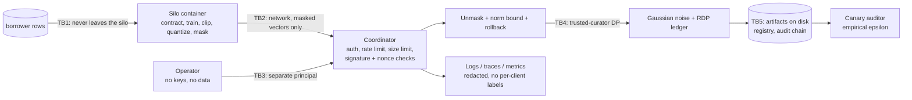

# Threat model

Method: STRIDE per trust boundary, plus an explicit adversary model for the protocol. Each row
maps a threat to the control that addresses it and to the test, bench script or CI job that proves
the control works. `scripts/check_baseline.py` verifies that every backticked evidence reference
exists.

## Adversary model

This is the part that decides which rows below exist at all, so it is stated first and plainly.

| Party | Assumed behaviour | What we defend |
|---|---|---|
| **Coordinator** | **Honest-but-curious.** Follows the protocol, but reads everything it receives and keeps it forever. | Individual updates stay hidden from it; it only ever reconstructs a sum. |
| **Silos** | **Malicious, up to `n - t` of them.** May send arbitrary updates, drop out at any stage, collude with each other. | Round integrity (norm bound, rollback), and the guarantee that colluding silos below the threshold learn nothing about a non-colluding silo. |
| **Operator** | **Semi-trusted.** Opens rounds and asks to advance stages. Holds no key material and sees no update. | Cannot close a stage early to isolate a silo; cannot forge a silo's message. |
| **Network** | **Active.** May reorder, replay, drop or modify anything in transit. | Signed messages bound to round nonces; TLS is the deployment's job, not this repo's. |

**Explicitly out of the model:** a *malicious coordinator*. One that lies about the survivor set can
run a round with a single silo and learn that silo's update exactly. Defending that needs a
verifiable shuffle, an attested enclave or client-side cross-checking of the survivor set, none of
which are implemented. The nearest partial mitigation that *is* implemented is that a stage cannot
be closed before everyone answers or it times out, which makes isolation cost a visible timeout
rather than being free (`tests/integration/test_silo_runner.py::test_the_operator_cannot_close_a_stage_early_to_exclude_silos`).

## System and trust boundaries

## TB1 -- the silo boundary (data never leaves)

| # | STRIDE | Threat | Control | Test / evidence |
|---|---|---|---|---|
| 1 | Information disclosure | A silo's raw rows reach the coordinator or another silo. | Only the masked vector built inside `SecAggClient` is ever handed to the transport; silo containers share no volume. | `tests/integration/test_service_api.py::test_no_request_body_ever_carries_a_plaintext_update`, `tests/integration/test_federated_run.py::test_the_transcript_of_a_full_run_carries_only_masked_vectors` |
| 2 | Information disclosure | A borrower value escapes inside a *validation error* that gets logged or forwarded. | Contract failures report column, check and count only. | `tests/unit/test_ml_contracts.py::test_failures_never_contain_borrower_values`, `tests/unit/test_metrics_and_data.py::test_contract_reports_column_check_and_count_without_values` |
| 3 | Tampering | A silo joins with a drifted or malformed schema, silently changing what a column means across silos. | Strict pandera contract (closed column set, no coercion) validated before the silo trains. | `tests/unit/test_ml_contracts.py::test_unexpected_columns_are_rejected`, `tests/unit/test_ml_contracts.py::test_a_missing_feature_column_is_rejected`, `tests/unit/test_ml_contracts.py::test_the_feature_order_is_fixed_and_excludes_the_label` |
| 4 | Information disclosure | A silo with one label class contributes a degenerate gradient that reveals its composition. | The contract refuses a single-class silo. | `tests/unit/test_ml_contracts.py::test_a_single_class_silo_is_rejected` |

## TB2 -- the network boundary (masked vectors only)

| # | STRIDE | Threat | Control | Test / evidence |
|---|---|---|---|---|
| 5 | Information disclosure | The transcript reveals an individual update. | Pairwise masks plus a self-mask make each `y_i` uniform over the ring; only a sum over a closed pairing set is informative. | `tests/unit/test_transcript_privacy.py::test_masked_words_look_uniform_over_the_ring`, `tests/unit/test_transcript_privacy.py::test_masked_words_are_uncorrelated_with_the_update_they_hide` |
| 6 | Information disclosure | The coordinator asks for both a silo's self-mask seed and its mask key, and subtracts its way to one update. | `reconstruct_aggregate` refuses any request that asks for both. | `tests/unit/test_secagg_exactness.py::test_reconstruction_refuses_to_reveal_both_secrets_of_one_client` |
| 7 | Information disclosure | Correlating the same silo's masked vectors across rounds. | The round nonce is the HKDF salt, so no mask seed repeats. | `tests/unit/test_transcript_privacy.py::test_two_rounds_of_the_same_update_produce_different_masked_vectors`, `tests/unit/test_crypto_keys_prg.py::test_derive_key_separates_purposes_and_rounds` |
| 8 | Spoofing | An attacker impersonates a silo or substitutes a mask key to learn an update. | Ed25519 signatures with pre-provisioned identity keys; clients verify the relayed pairing set themselves. | `tests/unit/test_messages.py::test_impersonation_and_wrong_kind_are_refused`, `tests/unit/test_messages.py::test_pairing_set_rejects_a_substituted_key`, `tests/unit/test_messages.py::test_pairing_set_rejects_two_clients_sharing_a_mask_key` |
| 9 | Replay | A captured message is replayed into a later round. | Every message carries and signs the round id and round nonce. | `tests/unit/test_messages.py::test_replaying_a_message_into_another_round_fails` |
| 10 | Tampering | A message body is modified in transit. | The signature covers the whole payload except the signature field. | `tests/unit/test_messages.py::test_a_modified_body_fails_verification`, `tests/unit/test_messages.py::test_signing_payload_excludes_only_the_signature` |
| 11 | Information disclosure | A peer reads the Shamir shares addressed to another peer. | Shares are sealed with AES-GCM under a per-pair HKDF key, with the round, sender and recipient as associated data. | `tests/unit/test_messages.py::test_share_aad_binds_round_sender_and_recipient`, `tests/unit/test_crypto_keys_prg.py::test_aead_binds_the_ciphertext_to_its_associated_data` |
| 12 | Elevation of privilege | An unauthenticated caller drives the protocol. | Every route requires an API key held only as a SHA-256 digest; protected routes fail closed when none is configured. | `tests/integration/test_service_api.py::test_every_route_requires_the_api_key`, `tests/unit/test_security.py::test_no_configured_keys_fails_closed` |
| 13 | Denial of service | A client floods the coordinator or sends an enormous vector. | Token-bucket rate limiting, body-size limit, base64 field length limits and a per-round byte budget that fails the round. | `tests/integration/test_app.py::test_rate_limit_rejects_bursts_and_exempts_probes`, `tests/unit/test_round_state_machine.py::test_the_byte_budget_fails_the_round`, `tests/unit/test_messages.py::test_base64_fields_reject_garbage_and_oversized_values` |
| 14 | Information disclosure | Error bodies leak protocol internals or submitted values. | Protocol exceptions map to fixed codes; no exception text or values in responses. | `tests/integration/test_service_api.py::test_protocol_failures_map_to_status_codes_without_leaking`, `tests/integration/test_app.py::test_validation_errors_never_echo_submitted_values` |

## TB3 -- the operator boundary

| # | STRIDE | Threat | Control | Test / evidence |
|---|---|---|---|---|
| 15 | Elevation of privilege | The operator closes ADVERTISE_KEYS after one silo answered, isolating it. | The coordinator refuses to close a stage until every registered silo answered or the stage timed out. | `tests/integration/test_silo_runner.py::test_the_operator_cannot_close_a_stage_early_to_exclude_silos`, `tests/unit/test_round_state_machine.py::test_a_stage_closes_on_timeout_with_whoever_answered` |
| 16 | Elevation of privilege | A silo opens a round and picks the pairing set. | Opening and advancing are operator routes; silos only submit their four message kinds. | `tests/integration/test_service_api.py::test_every_route_requires_the_api_key`, `tests/unit/test_round_state_machine.py::test_a_round_cannot_start_while_another_is_open` |
| 17 | Tampering | A round id is reused to replay a whole round. | Round ids must strictly increase and completed ids are remembered. | `tests/unit/test_round_state_machine.py::test_round_ids_are_never_reused`, `tests/unit/test_client_state.py::test_round_ids_must_strictly_increase` |
| 18 | Spoofing | A stolen API key is used to impersonate a silo. | The API key only authorizes transport; every protocol message is separately signed by the silo's identity key. | `tests/unit/test_messages.py::test_impersonation_and_wrong_kind_are_refused`, `tests/unit/test_round_state_machine.py::test_unknown_clients_and_forged_senders_are_refused` |
| 19 | Spoofing | A coordinator with no roster accepts anyone who connects. | Identity and roster are read from mounted files at start-up; a missing or malformed file refuses the boot. | `tests/integration/test_demos_cli.py::test_cli_serve_refuses_to_start_without_mounted_key_material`, `tests/integration/test_service_api.py::test_roster_and_identity_files_are_validated` |

## TB4 -- aggregation, poisoning and differential privacy

| # | STRIDE | Threat | Control | Test / evidence |
|---|---|---|---|---|
| 20 | Tampering | A malicious silo sends a huge update and steers the model. | The unmasked aggregate's norm is bounded by `survivors x C`; an over-long aggregate rejects and rolls back the round. | `tests/unit/test_round_state_machine.py::test_the_norm_bound_rejects_and_rolls_back_an_oversized_aggregate`, `tests/integration/test_federated_run.py::test_a_scaled_attacker_is_rejected_and_the_model_is_rolled_back`, `bench/bench_poisoning.py` |
| 21 | Tampering | **Accepted risk.** A sign-flipping silo stays inside the norm bound and is never rejected. | None. Attribution is impossible by construction; the impact is measured and published rather than hidden. | `tests/integration/test_federated_run.py::test_a_sign_flip_attacker_passes_every_check`, `bench/bench_poisoning.py` |
| 22 | Tampering | A modular wrap makes an honest sum decode to nonsense, or hides an attack. | The scale is chosen so `n·C·scale < 2^31`; encoding saturates rather than wrapping. | `tests/unit/test_quantize.py::test_honest_sums_never_wrap`, `tests/unit/test_quantize.py::test_encode_raw_saturates_instead_of_wrapping` |
| 23 | Information disclosure | The released aggregate leaks a training example. | Gaussian noise calibrated to the clip norm is added to every accepted aggregate. | `tests/unit/test_ledger_and_noise.py::test_added_noise_has_the_calibrated_scale`, `tests/unit/test_ledger_and_noise.py::test_noise_scale_follows_the_variant` |
| 24 | Repudiation | Training continues past the promised privacy budget. | A persisted RDP ledger refuses the round that would exceed the target, and survives restarts. | `tests/unit/test_ledger_and_noise.py::test_the_ledger_refuses_the_round_that_would_break_the_budget`, `tests/unit/test_ledger_and_noise.py::test_the_ledger_survives_a_restart`, `tests/integration/test_federated_run.py::test_the_budget_stops_the_run_before_the_target_is_exceeded` |
| 25 | Repudiation | A rejected round silently consumes budget. | Budget is charged only for accepted rounds. | `tests/integration/test_federated_run.py::test_a_rejected_round_spends_no_privacy_budget` |
| 26 | Repudiation | The accountant is wrong and the stated epsilon is fiction. | Cross-checked against Google's `dp-accounting`, and against the Gaussian closed form at full participation. | `tests/unit/test_accountant_reference.py::test_epsilon_matches_dp_accounting`, `tests/unit/test_accountant.py::test_full_participation_matches_the_gaussian_closed_form` |
| 27 | Repudiation | The *implementation* is wrong even though the accountant is right. | A one-shot canary audit estimates epsilon empirically; three deliberately broken variants must be flagged and the sound ones must not. CI fails otherwise. | `bench/bench_audit.py`, `.github/workflows/ci.yml#audit`, `tests/unit/test_privacy_audit_math.py::test_the_estimator_flags_a_claim_it_exceeds` |
| 28 | Repudiation | **Accepted risk.** The audit passes a subtly broken implementation. | None. The audit is a lower bound; `clip_after_noise` is shipped as a documented miss so the limit is visible rather than assumed away. | `bench/bench_audit.py`, `tests/unit/test_ledger_and_noise.py::test_clip_after_noise_only_rescales_and_so_preserves_direction` |
| 29 | Denial of service | Too many dropouts let the coordinator reconstruct from a tiny survivor set. | If survivors fall below `t`, the round fails instead of degrading. | `tests/unit/test_round_state_machine.py::test_too_many_dropouts_fail_the_round_rather_than_leak`, `tests/unit/test_client_state.py::test_a_client_refuses_to_unmask_below_the_threshold` |

## TB5 -- artifacts, telemetry and supply chain

| # | STRIDE | Threat | Control | Test / evidence |
|---|---|---|---|---|
| 30 | Tampering | A round record is edited, reordered or truncated to hide a rejected round or an epsilon spend. | Hash-chained round audit log, verifiable against an anchored head from the CLI. | `tests/unit/test_audit_chain_and_metrics.py::test_editing_a_record_breaks_the_chain`, `tests/unit/test_audit_chain_and_metrics.py::test_reordering_entries_is_detected`, `tests/unit/test_audit_chain_and_metrics.py::test_removing_the_tail_is_only_detected_with_an_expected_head` |
| 31 | Tampering | A model artifact is swapped between registration and load. | Content-addressed registry verifies hashes on load; tampered blobs and records are detected. | `tests/unit/test_ml_registry.py::test_tampered_blob_is_detected`, `tests/unit/test_ml_registry.py::test_tampered_version_record_is_detected` |
| 32 | Elevation of privilege | Loading a model artifact executes code. | No pickle anywhere in the source tree; npz loading refuses pickled arrays. | `tests/unit/test_no_pickle.py::test_source_tree_has_no_pickle_family_serialization`, `tests/unit/test_ml_serialization.py::test_pickled_npz_files_are_refused_on_load` |
| 33 | Tampering | A path-traversing model name writes outside the registry. | Names and references are validated before any path is built. | `tests/unit/test_ml_registry.py::test_path_traversal_and_invalid_names_are_rejected` |
| 34 | Information disclosure | Metrics labels profile individual silos over time. | Round metrics carry no per-client labels, and `/metrics` requires auth by default. | `tests/unit/test_audit_chain_and_metrics.py::test_metrics_carry_no_per_client_labels`, `tests/integration/test_service_api.py::test_metrics_endpoint_requires_auth_and_reports_rounds` |
| 35 | Information disclosure | Secrets or PII land in logs or tracebacks. | Redaction processor over structlog and stdlib records, including rendered exceptions. | `tests/unit/test_redaction.py::test_known_secret_and_pii_formats_are_redacted`, `tests/unit/test_logging.py::test_exception_tracebacks_are_redacted` |
| 36 | Information disclosure | Identity keys or API keys are committed. | Only `.env.example` ships; keys are generated at setup and mounted read-only; gitleaks in CI. | `.github/workflows/ci.yml#gitleaks`, `tests/unit/test_config.py::test_env_example_documents_every_setting` |
| 37 | Tampering | A vulnerable or unexpected dependency or base image ships. | pip-audit on the locked set, trivy on the image, hadolint on the Dockerfile, a syft CycloneDX SBOM, and base images pinned by digest. | `.github/workflows/ci.yml#pip-audit`, `.github/workflows/ci.yml#docker`, `tests/integration/test_check_baseline.py::test_unpinned_base_image_fails` |
| 38 | Elevation of privilege | A compromised container escalates on the host. | Non-root user, read-only root filesystem, all capabilities dropped, `no-new-privileges`, pids and memory limits. | `.github/workflows/ci.yml#docker`, `.github/workflows/ci.yml#compose` |

## Residual risks, stated plainly

1. **A malicious coordinator breaks privacy.** Out of model; see the adversary table.
2. **Norm-respecting poisoning is undetectable and unattributable.** Measured in `bench/bench_poisoning.py`, not mitigated.
3. **The empirical audit is a lower bound.** It catches gross errors and demonstrably misses `clip_after_noise`.
4. **Central DP requires trusting the coordinator to add the noise.** A coordinator that skips the noise still produces a plausible-looking run; only the audit would notice, and only for gross cases.
5. **`t - 1` colluding silos plus the coordinator can unmask a victim.** That is the threshold assumption, not a bug. Choose `t` accordingly.
6. **The audit chain and budget ledger are tamper-*evident*, not tamper-proof.** Whoever can write the files can reset spend; detecting tail truncation needs a head hash stored elsewhere.
7. **Local file locks assume a local filesystem.** Ledgers and audit writers coordinate through them, not through a distributed lock.
8. **TLS, key rotation and silo onboarding are deployment concerns** and are not implemented here.
